<!-- badges: start -->
[]()


[](https://opensource.org/licenses/MIT)

<!-- badges: end -->

# d3-service

Coordinating the YAML to DDL to Database pipeline.

This repository coordinates the development of a production database from the base [data model](https://github.com/UBC-DERC/data_model) to the construction of a [valid DDL](https://github.com/UBC-DERC/ddl_builder) (data definition language), and then the deployment of the actual database server to a Postgres Database. Once the database is deployed, data must be loaded into it, and data must be accessible. This tool connects the various pieces of this platform together.

```mermaid
flowchart LR
start --> data_model_output_yaml_check
data_model_output_yaml_check --yes--> ddl_output_check
data_model_output_yaml_check --no--> build_yaml_docker
build_yaml_docker --> yaml_output
yaml_output --> ddl_output_check
ddl_output_check --yes--> postgres_db_check
ddl_output_check --no--> build_ddl_docker
build_ddl_docker --> sql_output
sql_output --> postgres_db_check
postgres_db_check --yes--> build_postgrest_api_docker
postgres_db_check --no--> build_postgres_docker
build_postgres_docker --> confirmation_text_file
confirmation_text_file --> build_postgrest_api_docker
build_postgrest_api_docker --> check_data
check_data --yes--> done
check_data --no--> build_data_loading_docker
```



1. We create a simple Docker container for the data model, that reads in the YAML definition files and creates a single, validated YAML definition for the database.
2. We create a Docker container to convert the YAML output from (1) into Postgres compliant SQL that can then be read into the Postgres database.
3. We create the API to load and read data.
4. We load data.
5. The API is there and ready to use.

## Contribution

This project was developed by:

* [](https://orcid.org/0000-0002-2700-4605)  Simon Goring


Contributions to this repository are expected to follow the [Code of Conduct](CODE_OF_CONDUCT.md).

## Installing this Package

To install `d3-service` from this GitHub repository, either install using a graphical tool such as GitKraken or GitHub Desktop, or install from the console using:

```bash
git clone https://github.com//d3-service.git
cd d3-service
python -m pip install .
```

## How to Use this Repository

<!--
A short description of how this repository is expected to be used.
-->

## Funding Statement

<!--
A short statement about your funding sources.
-->

---

